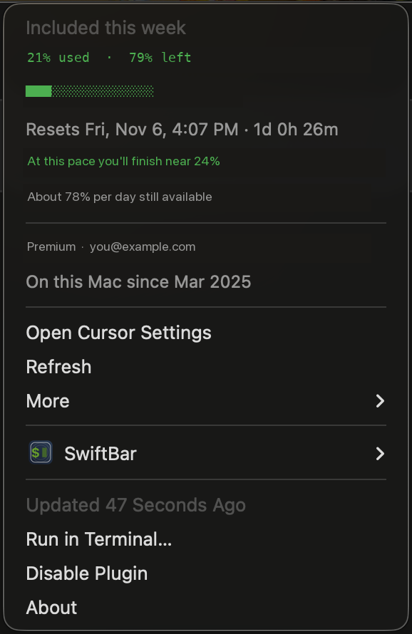
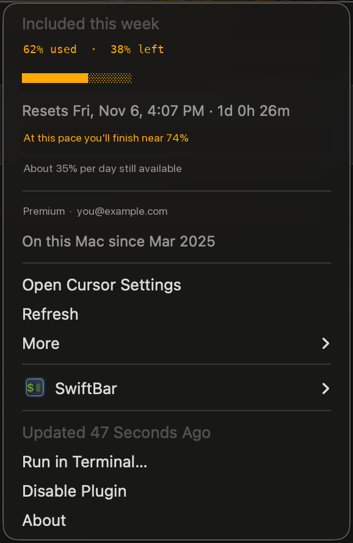
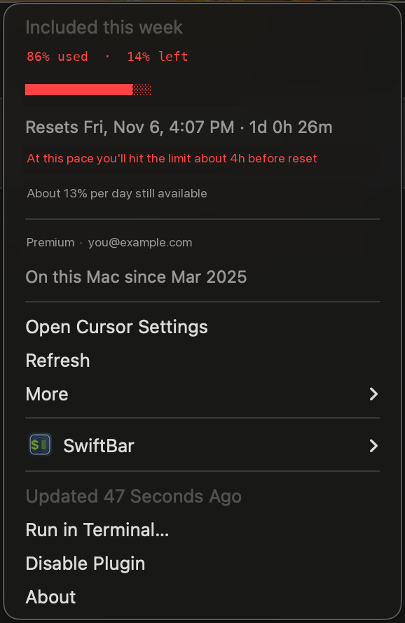

# Cursor Usage

A macOS menu bar plugin and a terminal report for your Cursor usage, from one shell script. It uses the Cursor login already on this machine.

- **Menu bar.** Shows how much of this billing cycle you have used. After the first 10% of the cycle, the dot follows your pace projected out to reset day: green under 50%, yellow from 50–79%, red at 80% and above. Percent plans, request quotas, and usage-based spend (the bar reads `$82/$1000`) all use the same script.
- **The dropdown.** Progress bars, the reset countdown, whether this pace runs out before reset, how much room is left per day, 14-day activity, your account, and the AI share of the last commit.
- **Your existing login.** The plugin reads the Cursor session on this Mac. On newer Cursor builds the token is encrypted in the login Keychain, so the first run asks you to let `security` read **Cursor Safe Storage**.
- **One script.** An executable shell script. It uses `bash`, `sqlite3`, and `curl`, which ship with macOS, and `python3` from the Xcode Command Line Tools. Clone it to `~/cursor-usage` and symlink the plugin. `git -C ~/cursor-usage pull` updates the menu bar and the report together.
- **A closer look.** `bash ~/cursor-usage/generate-report.sh` prints the billing cycle, token distribution, daily activity, conversations, and AI attribution as colored ASCII in the terminal.

## Demo

The dot color tracks that pace:

| Green (< 50%) | Yellow (50–79%) | Red (80%+) |
|:-:|:-:|:-:|
|  |  |  |
|  |  |  |

## Terminal report

Print a full usage report from the Cursor API and the local database:

```bash
bash ~/cursor-usage/generate-report.sh
```

The report covers the billing cycle, per-turn token distribution, daily activity, conversation analytics, AI code attribution, and account info. Output is colored ASCII in the terminal.

Save it to a file (colors turn off automatically when piped):

```bash
bash ~/cursor-usage/generate-report.sh > report.txt
```

Turn colors off explicitly:

```bash
bash ~/cursor-usage/generate-report.sh --no-color
```

Data sources and metrics are listed in [docs/data-sources.md](docs/data-sources.md).

## Installation

You need macOS Catalina 10.15 or later, Cursor installed and signed in at least once, the Xcode Command Line Tools (`xcode-select --install`), and [SwiftBar](https://github.com/swiftbar/SwiftBar).

Install SwiftBar if it is not already there:

```bash
brew install --cask swiftbar
```

Clone the repo into your home directory and point SwiftBar at it:

```bash
git clone https://github.com/edison-cc/cursor-usage.git ~/cursor-usage
mkdir -p ~/swiftbar-plugins
ln -sf ~/cursor-usage/cursor-usage.5m.sh ~/swiftbar-plugins/cursor-usage.5m.sh
```

Later, update both the plugin and the report with `git -C ~/cursor-usage pull`.

### Open it

Launch SwiftBar and choose `~/swiftbar-plugins` as the plugin directory. Open SwiftBar from the terminal (`open -a SwiftBar`), from Applications, or from Spotlight (Cmd+Space, then type "SwiftBar").

If SwiftBar is already running and the directory needs to change:

```bash
defaults write com.ameba.SwiftBar PluginDirectory "$HOME/swiftbar-plugins"
```

Restart SwiftBar. The plugin runs immediately and refreshes every **5 minutes**, from the `5m` in the filename.

### Check the login

Confirm the Cursor login and the API before involving SwiftBar:

```bash
bash ~/cursor-usage/tests/test-cursor-usage.sh
```

This calls the same Cursor APIs as the plugin and prints a plain-text summary. Your usage in that output means the login and the API are working.

### Change the refresh interval

The interval is the suffix on the plugin filename:

```bash
mv ~/swiftbar-plugins/cursor-usage.5m.sh ~/swiftbar-plugins/cursor-usage.10m.sh   # every 10 minutes
mv ~/swiftbar-plugins/cursor-usage.5m.sh ~/swiftbar-plugins/cursor-usage.30s.sh   # every 30 seconds
mv ~/swiftbar-plugins/cursor-usage.5m.sh ~/swiftbar-plugins/cursor-usage.1h.sh    # every hour
```

Supported suffixes: `s` (seconds), `m` (minutes), `h` (hours), `d` (days).

## Privacy

The script reads the Cursor session already stored on this Mac and sends it only to `cursor.com`. It does not store the token, and it does not send it anywhere else. Passwords are never read or transmitted.

On a team plan, `get-team-spend` returns every member's email and spend. The script keeps the signed-in account and deletes the response with its other temporary files.

The numbers come from the same dashboard endpoints the Cursor website uses. Those endpoints are not a published API and can change without notice.

This project is independent of Cursor and Anysphere.

## Troubleshooting

### Menu bar shows a red dot with "err"

Click it to see the error in the dropdown. Common causes:

- **"Cursor DB not found"** — Cursor IDE hasn't been opened on this machine, or is installed in a non-standard location.
- **"No access token"** — You're not signed in to Cursor. Open Cursor, sign in, then click Refresh.
- **"Keychain access to Cursor Safe Storage was denied"** — see [Keychain prompt](#keychain-prompt) below, then click Refresh.
- **"Cursor session expired"** — Cursor's API rejected the stored login. Open Cursor (signed in) so it refreshes the token, then click Refresh.
- **"Invalid Cursor token"** / **"Could not decrypt the Cursor token"** — Sign out of Cursor and back in.

### Keychain prompt

Newer Cursor builds encrypt the stored login token (setting `cursor.storage.authTokenEncryptionAtRest`). To decrypt it, the plugin reads the **Cursor Safe Storage** key from your login Keychain, so the first run shows a prompt asking to let `security` access it. Enter your login password. **Allow** asks again on every refresh. **Always Allow** stores the permission on `/usr/bin/security`, so any program on this Mac can then run `security` and read **Cursor Safe Storage** without a new prompt. Some Macs have two **Cursor Safe Storage** items (accounts `Cursor` and `Cursor Key`); if the first one doesn't decrypt the token, a second prompt appears for the other.

### Usage-based plans

On usage-based (token-based) plans there are no included requests, so the menu bar shows spend only (e.g. `$82/$1000`) and the dropdown labels it **Spend This Cycle**.

### Plugin doesn't appear in menu bar

- Verify SwiftBar is running (check for its icon in the menu bar).
- Confirm the plugin directory is set: `defaults read com.ameba.SwiftBar PluginDirectory`
- Check the plugin is executable: `ls -la ~/swiftbar-plugins/cursor-usage.5m.sh`
- If using a symlink, verify it's not broken: `file ~/swiftbar-plugins/cursor-usage.5m.sh`

### Data looks stale

- Click the plugin in the menu bar and select **Refresh**.
- Or right-click the SwiftBar icon → Refresh All.
- The script has a 15-second timeout per API call. On slow networks, it may show stale data from the last successful run.
